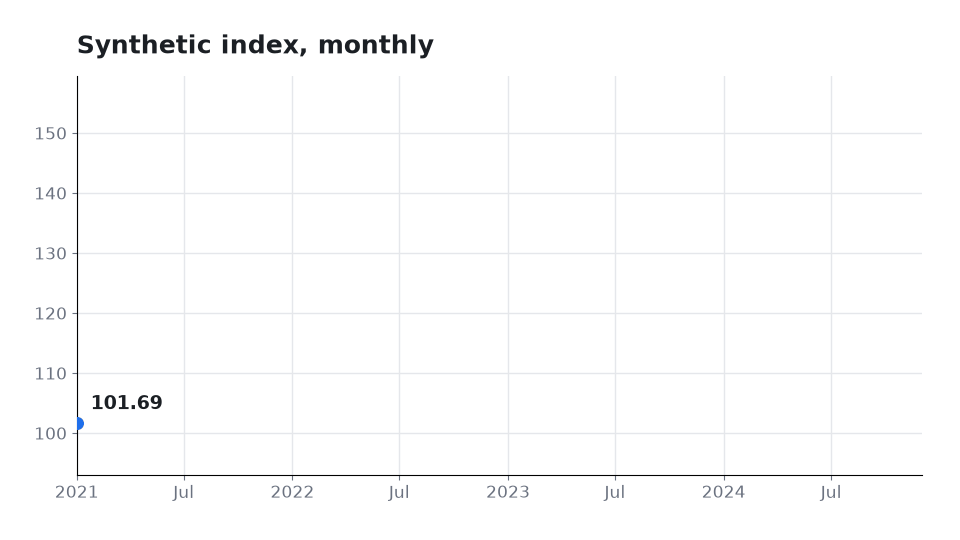

# animated-chart-cli

A small Python command-line tool that turns a CSV file into an animated chart.

- **Line chart**: a `date,value` CSV is revealed from left to right over time.
- **Bar race**: a `frame,name,value` CSV becomes a ranking race, with bars sliding past each other between frames.

Output is a GIF written with Pillow, so no ffmpeg is needed. MP4 is supported only when `ffmpeg` is on your PATH.



The example data in `examples/` is synthetic (generated with a fixed random seed). It does not represent any real market, company or person.

## Install

Tested with Python 3.12.

```bash
pip install -r requirements.txt
```

For running the tests, also install the development requirements:

```bash
pip install -r requirements-dev.txt
```

## Usage

Line chart (`date,value` CSV):

```bash
python -m chart_anim examples/sample_line.csv -o examples/sample_line.gif --type line --fps 12
```

Bar race (`frame,name,value` CSV):

```bash
python -m chart_anim examples/sample_bar_race.csv -o examples/sample_bar_race.gif --type bar-race --fps 12 --top 6
```

Options:

| Option | Default | Meaning |
|---|---|---|
| `input` | required | input CSV |
| `-o, --output` | required | output file, `.gif` or `.mp4` |
| `--type` | `line` | `line` or `bar-race` |
| `--fps` | `12` | frames per second, 1 to 60 |
| `--duration` | `6` | line chart: seconds for the full reveal |
| `--transition` | `0.5` | bar race: seconds between two frames |
| `--top` | `10` | bar race: number of bars shown at once |
| `--title` | none | optional chart title |

### Input format

- `date,value`: `date` must parse as a date (for example `2024-01-31`), `value` must be a finite number. Rows are sorted by date. At least two rows with two distinct dates.
- `frame,name,value`: `frame` is a whole number (a year, a period index, ...), `name` is non-empty, `value` is zero or positive. Each `(frame, name)` pair appears once. Missing names in a frame count as 0. At least two distinct frames.

Extra columns are ignored.

### Errors

Invalid input or options print a message starting with `error:` to stderr and exit with code `2`. The message names the missing column or the bad row, for example:

```
error: column 'value' must be a finite number: row 2 (value='x')
```

## Tests

```bash
pytest
```

The tests cover CSV validation errors, the frame count of a line chart, the frame count and output of a GIF written by the CLI, and the bar-race ranking order.

## Limitations

- Output is GIF (256 colours per frame) or MP4 (needs `ffmpeg` on PATH). GIF frame timing is stored in centiseconds, so `--fps` is approximate (for example 12 fps is stored as 80 ms per frame).
- All frames are held in memory before writing, so very long animations or very large chart sizes use a lot of RAM.
- The line chart shows one series. Values are not smoothed, so each data point appears as a straight segment.
- The bar race requires non-negative values and shows only the top `--top` bars. Rank changes are animated by interpolating positions between keyframes; there is no extra easing.
- The chart size is fixed at 960 x 540 px. There are no options for colours, fonts or axis formatting.

## Project layout

```
chart_anim/
  __main__.py   command-line interface
  io.py         CSV loading and validation
  render.py     frame drawing (matplotlib) and GIF/MP4 output
tests/          pytest suite
examples/       synthetic sample CSVs and the generated GIFs
```

## License

MIT. See [LICENSE](LICENSE).
